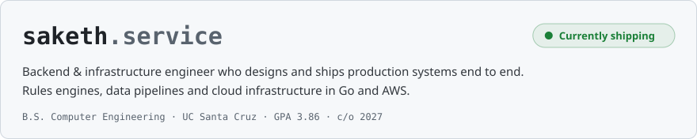
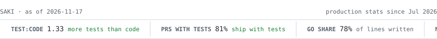
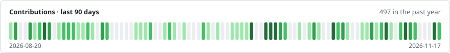
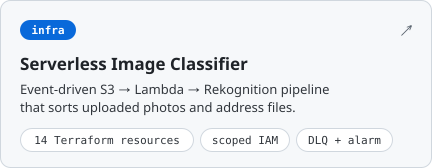
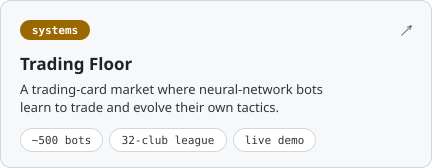
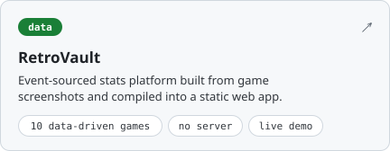
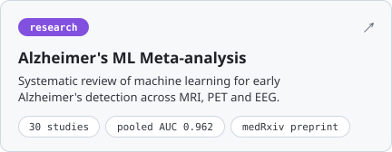
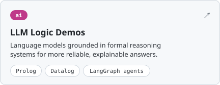
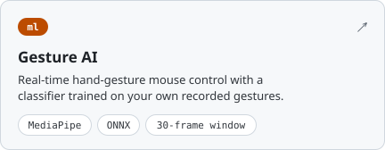

<picture>
  <source media="(prefers-color-scheme: dark)" srcset="assets/header-dark.svg">
  
</picture>

<picture>
  <source media="(prefers-color-scheme: dark)" srcset="assets/ticker-dark.svg">
  
</picture>

### What I work on

| Area | What I've built |
| :-- | :-- |
| **AI code generation** | An agentic platform in Go where Claude agents, behind PII, structural and calibration gates, generated and shipped 200+ production rules that run ~200K evaluations a day. |
| **Decision engines** | A shadow-mode financial-document analysis engine (deposit sourcing, undisclosed-debt detection, statement reconciliation) held to a 95% precision floor before it may auto-clear anything. |
| **Reliability** | Own a Temporal ingestion pipeline across 3 services: added write-availability metrics that exposed silent record corruption, and killed a poison-retry loop on malformed partner payloads. |
| **Platform infrastructure** | Founding infra lead on a hybrid on-prem/GCP Kubernetes platform: Terraform-provisioned GPU/TPU nodes, HA control plane, zero-trust networking (Calico eBPF, Envoy mTLS), PostgreSQL failover. |
| **AI applications** | An AI outreach platform (Claude, Gmail API) running drafting, reply classification and follow-up across 2,500+ accounts, on multi-tenant RBAC with hardened auth. |
| **Backend & testing** | Production Go across 47 packages and 14 schema changes; 153 test files, 1.33 lines of test per line of code. |
| **Cloud** | [Serverless Image Classifier](https://github.com/sakisaki-dev/AWS-Serverless-ImageClassifier): S3 → Lambda → Rekognition on 14 Terraform resources, least-privilege IAM, a dead-letter queue and an error alarm. |
| **Simulation & ML** | [Trading Floor](https://github.com/sakisaki-dev/trading-floor): ~500 neural-network bots evolving trading tactics. [Gesture AI](https://github.com/sakisaki-dev/Gesture-AI-): real-time hand tracking into a custom ONNX classifier. |
| **Research** | [Meta-analysis of 30 studies](https://github.com/sakisaki-dev/Deep-Learning-for-Early-Detection-of-Alzheimer-s-Disease-Meta-Analysis-) on ML for early Alzheimer's detection (pooled AUC 0.962), published as a medRxiv preprint. |

<picture>
  <source media="(prefers-color-scheme: dark)" srcset="assets/activity-dark.svg">
  
</picture>

### Featured work

<a href="https://github.com/sakisaki-dev/AWS-Serverless-ImageClassifier"><picture><source media="(prefers-color-scheme: dark)" srcset="assets/card-classifier-dark.svg"></picture></a>
<a href="https://github.com/sakisaki-dev/trading-floor"><picture><source media="(prefers-color-scheme: dark)" srcset="assets/card-trading-floor-dark.svg"></picture></a>

<a href="https://github.com/sakisaki-dev/RetroVault"><picture><source media="(prefers-color-scheme: dark)" srcset="assets/card-retrovault-dark.svg"></picture></a>
<a href="https://github.com/sakisaki-dev/Deep-Learning-for-Early-Detection-of-Alzheimer-s-Disease-Meta-Analysis-"><picture><source media="(prefers-color-scheme: dark)" srcset="assets/card-alzheimers-dark.svg"></picture></a>

<a href="https://github.com/sakisaki-dev/LLM-Logic-Demos"><picture><source media="(prefers-color-scheme: dark)" srcset="assets/card-llm-logic-dark.svg"></picture></a>
<a href="https://github.com/sakisaki-dev/Gesture-AI-"><picture><source media="(prefers-color-scheme: dark)" srcset="assets/card-gesture-ai-dark.svg"></picture></a>

### Stack

<picture>
  <source media="(prefers-color-scheme: dark)" srcset="assets/stack-dark.svg">
  
</picture>

 

**Contact** · [samachir@ucsc.edu](mailto:samachir@ucsc.edu) · [LinkedIn](https://www.linkedin.com/in/saketh-mach/)
